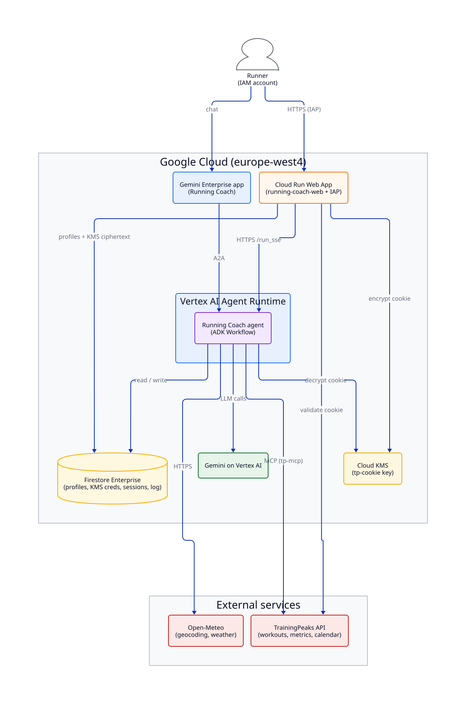
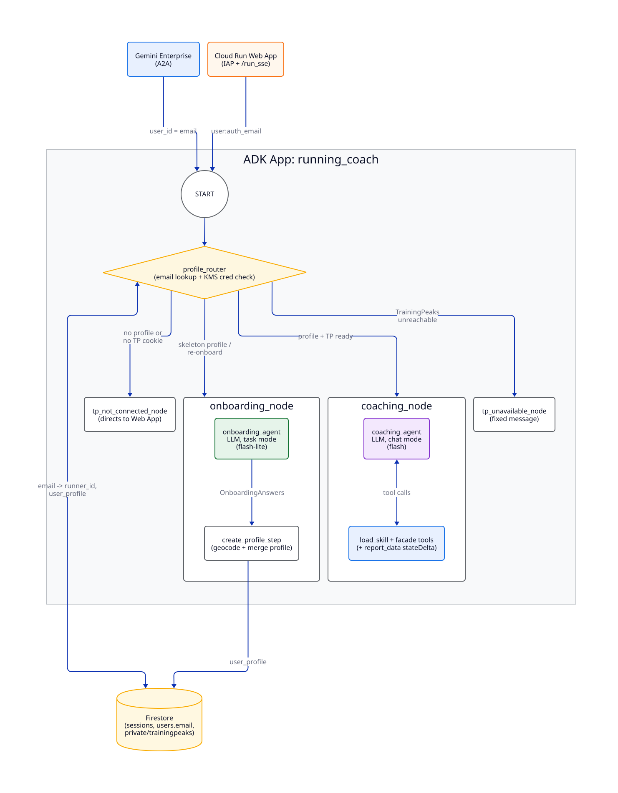
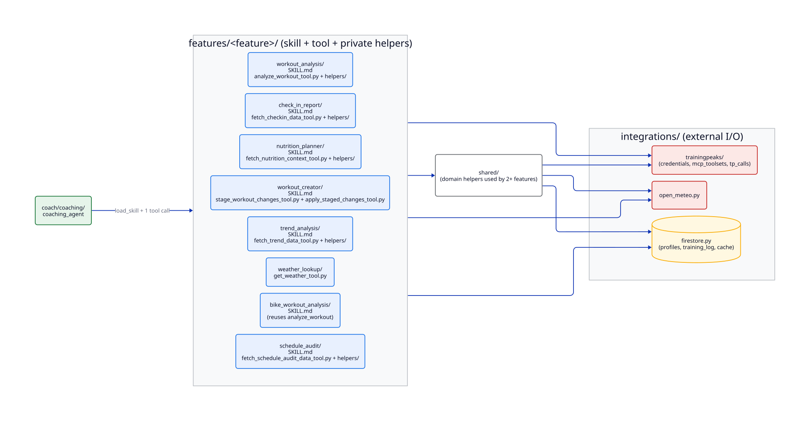
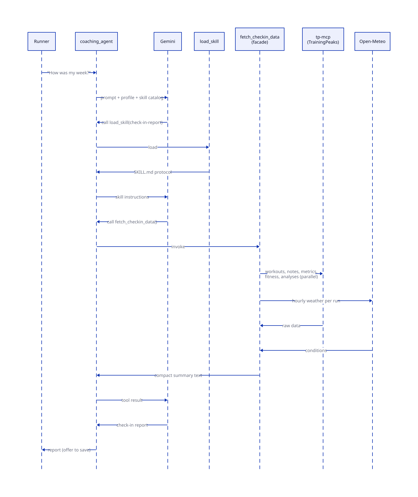
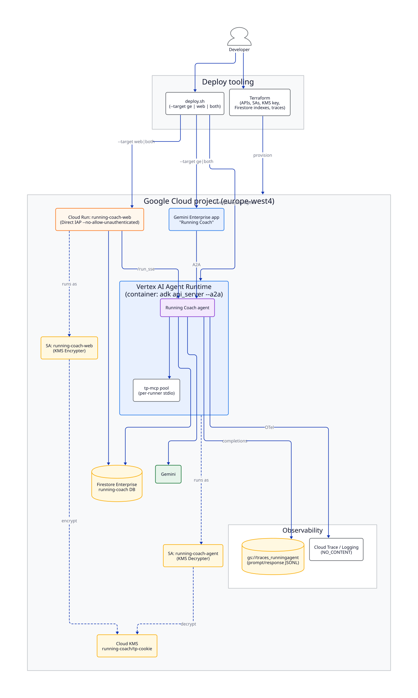

# Running Coach: Architecture

The AI Running Coach is a running coach and exercise physiologist served through a **Cloud Run Web App** (`running-coach-web`) protected by **Identity-Aware Proxy (IAP)** and backed by **Vertex AI Agent Runtime**. It reads training data from **TrainingPeaks** and weather from **Open-Meteo**, stores profiles, KMS-encrypted credentials, sessions, and training logs in **Firestore**, and coaches with Gemini models.

| | |
|---|---|
| Front end | Cloud Run `running-coach-web` (React SPA + FastAPI BFF behind Direct IAP) |
| Agent runs on | Vertex AI Agent Runtime, custom container, `europe-west4` |
| Framework | Agent Development Kit (ADK) `Workflow` |
| Models | Gemini flash (coaching), Gemini flash-lite (onboarding, history summaries) |
| Security | Cloud Run Direct IAP (ES256 JWT) + Cloud KMS envelope encryption (`running-coach/tp-cookie`) |
| Data | Firestore Enterprise (`running-coach` DB), TrainingPeaks via MCP, Open-Meteo |



---

## 1. ADK workflow



The root agent (`agent.py`) is an ADK `Workflow` with one deterministic router and five nodes (`coach/`):

- **`profile_router`** (no LLM) resolves the authenticated runner's email (`user:auth_email` from the Cloud Run Web App, or `DEV_RUNNER_EMAIL` in local `adk web`), looks up `users` in Firestore via the `users_by_email` index, verifies that `users/{runner_id}/private/trainingpeaks` holds a KMS-encrypted TrainingPeaks cookie, and routes to one node. Re-reading Firestore on web turns ensures profile edits saved in the Web App take effect on the very next coaching message.
- **`not_linked_node`** directs an unlinked account to `WEB_APP_URL` to connect TrainingPeaks and create a profile.
- **`tp_not_connected_node`** directs a runner whose profile lacks an active encrypted TrainingPeaks cookie to reconnect from the Web App.
- **`onboarding_node`** runs `onboarding_agent` in *task mode* (`coach/onboarding/`). It collects either a **single goal** or a **goal plan** (stepping-stone sub-goals leading to a North Star race) as a structured `OnboardingAnswers` object, geocodes the runner's city, and merges the profile into Firestore while preserving `email` and any saved sub-goal race results.
- **`coaching_node`** runs `coaching_agent` in *chat mode* (`coach/coaching/`). Its instruction is an ADK *InstructionProvider* (`build_coach_instruction`) that derives the date, profile summary, active goal block, and goal notices from `user_profile` on every model call.
- **`profile_unavailable_node`** returns a fixed message when Firestore cannot be reached, preventing a known runner from ever being misrouted to onboarding.

**Goal plans.** A plan stores `north_star` and `sub_goals`, each a full training block with a `start_date` and a finishing race (`race_date`). `shared/goal_plan.py` derives `current_goal` with the same keys as a single goal (`training_goal`, `timeline`, `goal_set_date`), keeping trajectory, taper, and race projection maths unified.

**Session handling.** Sessions are stored in Firestore keyed by `web_<email>`. In the Web App, clicking "New conversation" or any quick-action button starts a fresh session, while typed follow-ups continue the active conversation. Only events from the last 4 hours are loaded into the model (`GetSessionConfig.after_timestamp`), so a session idle for more than 4 hours starts with a clean context; every 10 turns within an active window, ADK event compaction summarises older history. Firestore TTL (`expire_at`, 7 days after last activity) deletes abandoned session documents and their event subcollections.

---

## 2. Feature slices, tool calling & structured report state



Each coaching capability lives in its own vertical slice under `features/<feature>/` rather than calling 60+ raw TrainingPeaks MCP tools directly:

1. **Co-located Skills** (`features/<feature>/SKILL.md`, next to the feature's `*_tool.py`) hold the coaching protocol and output template for each task, loaded on demand via `load_skill`.
2. **Feature Tools & Private Helpers** (`features/<feature>/<tool_name>_tool.py` + `helpers/`): each feature tool runs MCP calls, Open-Meteo lookups, and Firestore reads in parallel, computes physiological metrics in deterministic Python using its private `helpers/` and `shared/`, and returns a compact summary.
   - `fetch_checkin_data`, `fetch_trend_data`, and `fetch_schedule_audit_data` also write structured JSON payloads (`checkin_report_data`, `trend_report_data`, and `audit_report_data`, `version: 1`) into `tool_context.state`. The Cloud Run Web App BFF extracts these whitelisted `stateDelta` keys from `/run_sse` and streams `event: report` frames so interactive charts render from the exact numbers used in the prose.



---

## 3. Code map & architectural boundaries

```
running_coach/
├── agent.py                         # ADK entrypoint: root_agent + app
├── coach/                           # workflow orchestration
│   ├── model_config.py  profile_router.py  profile_lookup.py
│   ├── onboarding/                  # onboarding_agent, profile_creation, request_new_goal_tool
│   └── coaching/                    # coaching_agent, instruction, skill_toolset, model_callbacks
├── features/                        # vertical slices: SKILL.md -> *_tool.py -> private helpers/
│   ├── check_in_report/             # SKILL.md, fetch_checkin_data_tool.py, helpers/
│   ├── trend_analysis/              # SKILL.md, fetch_trend_data_tool.py, helpers/
│   ├── workout_analysis/            # SKILL.md, analyze_workout_tool.py, no_workout_reply_callback.py, helpers/
│   ├── bike_workout_analysis/       # SKILL.md (reuses analyze_workout)
│   ├── schedule_audit/              # SKILL.md, fetch_schedule_audit_data_tool.py, helpers/
│   ├── nutrition_planner/           # SKILL.md, fetch_nutrition_context_tool.py, helpers/
│   ├── workout_creator/             # SKILL.md, create_workout_tool.py, create_note_tool.py, helpers/
│   └── weather_lookup/              # get_weather_tool.py
├── shared/                          # domain helpers used by 2+ features/coach
│   ├── dates  units  sports  session_state  runner_identity  parallel_fetch  tp_payloads
│   ├── goal_plan  goal_distance  race_equivalents  goal_plan_summary  progress_verdicts
│   ├── weekly_buckets  calendar_notes  long_run_rule  health_metrics  athlete_settings  hr_pace_fit
│   ├── analysis_summary  workout_status  workout_structure  runner_weather  web_report_payload
│   └── training_log/                # record_builder, record_writer, telemetry_file
├── integrations/                    # external I/O only
│   ├── config  package_paths  firestore  session_service  open_meteo
│   └── trainingpeaks/               # credentials, mcp_toolsets, tp_calls
├── webapp/
│   ├── backend/app/                 # FastAPI BFF (IAP auth, profiles, TP connect, SSE translator)
│   └── frontend/src/                # React SPA: app/, features/{check_in_report,trend_analysis,schedule_audit,profile}/, shared/
└── tests/                           # behavioural feature/coach tests + test_structure.py
```

**Cross-stack report mapping:**

| Agent feature | State key → BFF (`events.py`) | Report kind → SPA | SPA folder (`webapp/frontend/src/`) |
|---|---|---|---|
| `check_in_report` | `checkin_report_data` | `checkin` | `features/check_in_report/` |
| `trend_analysis` | `trend_report_data` | `trend` | `features/trend_analysis/` |
| `schedule_audit` | `audit_report_data` | `audit` | `features/schedule_audit/` |

**Architectural invariants (enforced by `tests/test_structure.py`):**
1. Every skill lives at `features/<feature>/SKILL.md` (skill name = kebab-case folder name), and every `<tool_name>_tool.py` defines one `FunctionTool` registered on `coaching_agent`.
2. `features/<x>/helpers/` is private to its feature; features never import other features, and `coach/` only imports `*_tool.py` and `*_callback.py` from `features/`.
3. Every `shared/` module serves at least 2 consumers; `shared/` and `integrations/` never import `features/` or `coach/`.
4. Outside `integrations/`, external I/O is called through module-qualified imports (`firestore.*`, `open_meteo.*`, `tp_calls.*`, `credentials.*`).
5. Frontend `src/features/<x>` folders never cross-import; `src/app/` composes features and `src/shared/` imports neither.

---

## 4. Integrations, credentials, and data

- **TrainingPeaks & Cloud KMS:** Runners upload their `Production_tpAuth` cookie in the Web App. The backend validates it live against TrainingPeaks and encrypts it with Cloud KMS (`AAD = b"users/{runner_id}"`) into `users/{runner_id}/private/trainingpeaks`. Inside Agent Runtime, `integrations/trainingpeaks/credentials.py` decrypts the runner's cookie (5-minute TTL cache) and `integrations/trainingpeaks/mcp_toolsets.py` maintains an LRU pool of `tp-mcp` stdio toolsets keyed by cookie hash.
- **Open-Meteo (`integrations/open_meteo.py`):** Geocoding (cached on the profile), exact-hour historical run weather, and forecasts for fueling/schedule audits.
- **Firestore (`running-coach` Enterprise DB, `integrations/firestore.py`):**
  - `users/{runner_id}`: runner profile + `email` (indexed via `google_firestore_index.users_by_email`).
  - `users/{runner_id}/private/trainingpeaks`: KMS ciphertext + metadata (`tp_athlete_id`, `tp_name`, `kms_key_version`).
  - `users/{runner_id}/training_log/{workout_id}`: structured workout history indexed by date (`google_firestore_index.training_log_by_date`).
  - `users/{runner_id}/workout_analyses/{workout_id}`: 90-day TTL projection cache (`google_firestore_field.workout_analyses_ttl`).
  - `<root>/running_coach/users/{user_id}/sessions/{session_id}` (+ `events` subcollection): ADK sessions with 7-day TTL (`google_firestore_field.sessions_ttl`, `google_firestore_field.session_events_ttl`).

---

## 5. Deployment and security



- **Terraform** provisions APIs, two least-privilege service accounts (`running-coach-agent` with `cryptoKeyDecrypter` and `running-coach-web` with `cryptoKeyEncrypter`), the `running-coach/tp-cookie` KMS key, Firestore Enterprise indexes/TTL, and `gs://traces_runningagent`.
- **`deploy.sh [--dry-run]`** deploys the agent to Vertex AI Agent Runtime via `agents-cli deploy`, then deploys `running-coach-web` to Cloud Run with Direct IAP (`--no-allow-unauthenticated --iap`) via `webapp/deploy.sh`.
- **Defense-in-depth auth:** Cloud Run Direct IAP gates access via IAM (`roles/iap.httpsResourceAccessor`), and the FastAPI backend independently verifies the `X-Goog-IAP-JWT-Assertion` ES256 signature and audience on every `/api/*` call.

## 6. Observability

- **OpenTelemetry → Cloud Trace / Logging** for end-to-end latency visibility.
- **Privacy-preserving telemetry (`NO_CONTENT`)**: prompts and completions are uploaded as JSONL to `gs://traces_runningagent/completions/` rather than emitted in trace attributes.

---

*Diagrams are written in d2 (`docs/diagrams/*.d2`). To regenerate them:*

```bash
cd docs/diagrams && for f in *.d2; do d2 --layout=elk "$f" "${f%.d2}.svg"; done
```
